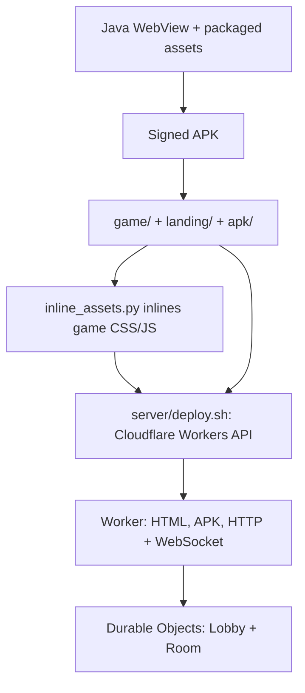

# Scorched Tanks — build, deployment and release guide

**Audited against repository source v1.15 on 2026-10-31.** These are source-grounded procedures and cautions. A clean release build and production deploy were **not** performed by this review. Do not interpret a successful `/health` response as proof of a working Android/online game.

## Endpoints in checked-in source

| Endpoint | URL/meaning |
|---|---|
| Canonical Worker (referenced by source) | `https://scorched-tanks.yishai-k.workers.dev` |
| Marketing domain used in links | `https://tanks.yishaik.com` (routing/DNS must be independently verified) |
| Web | `/play` |
| APK | `/download` |
| Invite | `/join/ABCD` or browser `/play#room=ABCD` |
| Health | `/health` |
| App Links | `/.well-known/assetlinks.json` |
| API | `POST /api/room`, `GET /api/room/ABCD` |
| WebSocket | `wss://scorched-tanks.yishai-k.workers.dev/ws/quick` and `/ws/room/ABCD` |

These endpoints come from `server/worker.js`. Remote availability, DNS alias configuration and current published contents have not been checked.

## Release architecture



### Local web development (safe, no production writes)

```bash
python3 -m http.server 8000 --directory game
python3 server/inline_assets.py game /tmp/scorched-game.html
```

The browser serves local CSS/JS and references fonts from Google. Opening `game/index.html` from disk is possible in supported browsers with adjacent assets, but localhost HTTP provides a more consistent test origin.

### Android build: important current limitations

**The checked-in `build.sh` is NOT a portable build script.** Its lines 5–8 reference `/workspace/work/apk`, `/workspace/work/scorched-android`, and an unrelated built-site HTML path. Running it unmodified against a fresh clone cannot be relied on to build the checked-in game. Fix and review those paths before using it for a release. Never assume that it packages `game/index.html` as currently committed.

Historical manual pipeline: Android platform-34 `android.jar`; aapt; Java compilation; d8; APK package; zipalign; apksigner. It accepts `KS_PASS` (required) and `VC` (versionCode, also used to form `1.<VC>`). The script will **create a new signing keystore if the expected key is absent**. This can irreversibly break in-place upgrades for an existing installation; a release script should fail closed instead.

A separate Gradle project is present in `android/`:

- Android Gradle Plugin 8.5.2; JDK 17; minSdk 24; targetSdk 34.
- Its checked-in `versionCode=1`, `versionName=1.0`; `release` currently uses a debug signing config.
- There is **no checked-in Gradle wrapper**. Use a known Gradle/Android Studio environment for development builds, not as an assumed production signing/release path.
- The historical manual aapt build uses `--target-sdk-version 28`, differing from Gradle's targetSdk 34. Verify the actual compiled manifest for any released APK.

**Never commit or print `key.jks` or passwords.** Keep release signing material outside Git, preserve signer continuity, and confirm APK fingerprint before distribution.

### Server deployment (writes production)

`server/deploy.sh` is a real production update. It:

1. Copies `landing/index.html` into `server/landing.txt`.
2. Inlines local game CSS/JS into `server/game.txt` with `inline_assets.py`.
3. Copies `apk/ScorchedTanks.apk` to `server/app.apk.bin`.
4. Uploads `worker.js`, text assets and APK using `CF_API_TOKEN` and `CF_ACCOUNT_ID` (defaults to the historical account configured in script).
5. Requests `/health`; it does not currently assert the JSON Cloudflare API success flag or run a full post-deploy test suite.

The script currently uses `server/meta-update.json`, which retains existing `Lobby`/`Room` Durable Object bindings and **does not** re-run a migration. `server/metadata.json` carries the original `v1` migration and is for initial provisioning only. Do not resend that migration on an existing Worker.

Example invocation **only after staging/review and release verification**:

```bash
# This command DEPLOYS to the configured account. Do not run for a smoke test.
CF_API_TOKEN=... CF_ACCOUNT_ID=... ./server/deploy.sh
```

Prefer a narrow-scope Workers deployment token, secret injection through an approved runner and a staging Worker/account for rehearsal. Never put tokens in shell history or log output when you can avoid it.

## Release checklist

- [ ] Work from a reviewed PR; confirm current `main` base SHA and review diffs.
- [ ] Reconcile and bump `GAME_VER` in `game/index.html`, `APP_VER` in `server/worker.js`, and landing footer version. Document in `CHANGELOG.md`.
- [ ] Fix/build from repository-relative Android asset inputs; verify source checksum packaged in APK.
- [ ] Verify manifest package, min/target SDK, `versionCode`, `versionName` and signer fingerprint; reuse existing release keystore.
- [ ] Confirm the APK in `apk/` is the intended signed artifact; verify `/download` content will match it.
- [ ] Run local mobile and multi-client tests per [TESTING](docs/TESTING.md); stage server/DO changes before production.
- [ ] Inspect Worker bundle and migration metadata; use `meta-update.json` on existing Worker.
- [ ] Make a backup of repo commit/previous APK/Worker bundle and record rollback procedure; keep private credentials outside the repo.
- [ ] Deploy intentionally; inspect API response **and** `/health`, `/play`, `/download`, WebSocket room lifecycle.
- [ ] Test fresh install, update over previous APK, invite/deep links and two-client online match.
- [ ] Record deployed git SHA, APK SHA256, version and signer fingerprint in a private release log.

## Rollback / recovery

- A Worker rollback must restore a previously tested Worker script **and its matching inlined HTML/APK** (a Worker-only code rollback may retain incompatible assets).
- Do not reapply or automatically undo Durable Object schema migrations. This repo stores game room metadata and last snapshots; assess data compatibility and room expiration first.
- For Android, previously installed clients can be upgraded only with the same signing identity and appropriate versionCode progression. Do not invent/regenerate a missing production key.
- A stable `/health` after rollback does not prove clients rejoin correctly; do a full two-client round.

See [architecture](docs/ARCHITECTURE.md), [protocol](docs/PROTOCOL.md), [testing](docs/TESTING.md), and [audit](docs/REVIEW-2026-10-31.md).
