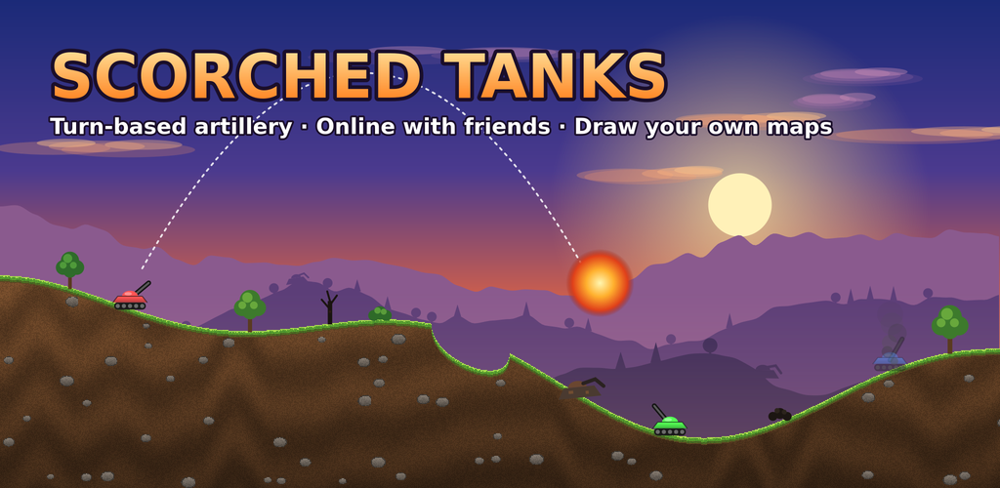
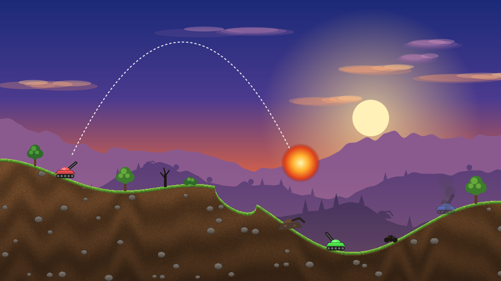
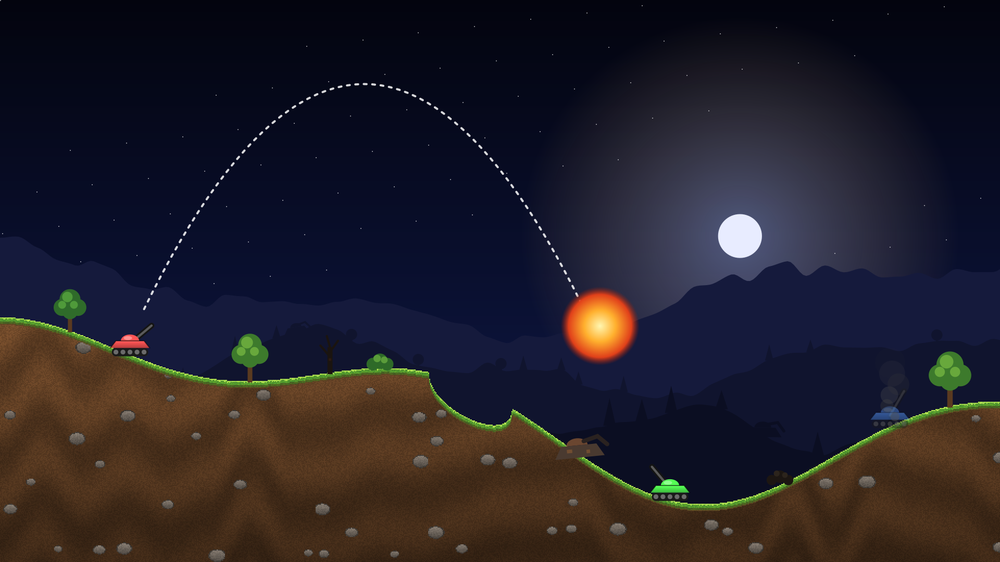
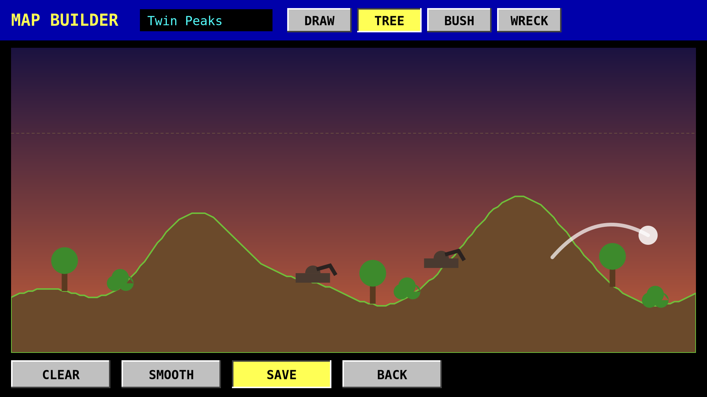
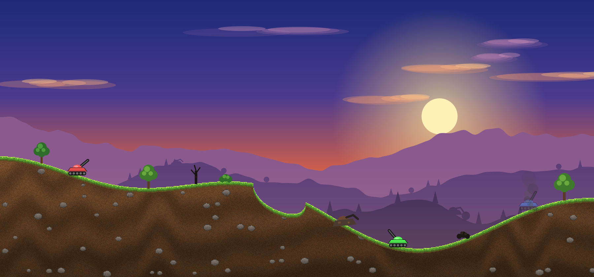

# Scorched Tanks

**Aim. Fire. Scorch the earth.**

The turn-based tank artillery classic, rebuilt for your phone and your browser. Play with friends online, or draw your own battlefield with a finger.

    

---

## Screenshots

| Sunset battle | Night battle |
|:---:|:---:|
|  |  |
| **Map builder** | **Burning trees and old wrecks** |
|  |  |

## Why you'll love it

🎯 **One shot, perfect angle.** Set the angle and power, read the wind, and fire. Then watch the hill you were hiding behind disappear.

💣 **Over 30 weapons.** Baby Missiles to Nukes, MIRVs, Funky Bombs, Napalm, Rollers, Diggers, Sandhogs, Dirt Balls, the Earth Disrupter and a Laser.

🛡️ **Gear up between rounds.** Shields, parachutes, guidance systems and fuel, bought one unit at a time. Hold BUY to stock up fast.

🌐 **Online with friends.** Quick match with strangers, or a private room with a 4-letter code and an invite link. A dropped player becomes a CPU, and the game carries on.

✏️ **Draw your own maps.** Sketch the ground with a finger and place trees, bushes and old wrecks. Your maps work online too: every player gets the host's map.

🎨 **Modern or Classic.** A hand-painted look with sunset skies, grassy hills, trees that burn and smoking wrecks. Or the original DOS look, one tap away.

🤖 **7 AI personalities.** Moron, Shooter, Poolshark, Tosser, Chooser, Spoiler and Cyborg, from hopeless to deadly.

⚙️ **Your rules.** Local games support 2 to 10 tanks; online private rooms created by the app default to 4 seats. Choose rounds, starting cash, wind, walls (wrap, padded, concrete), terrain, gravity and sky.

## How to play

1. **Aim:** drag on the battlefield, or use the Angle and Power steppers.
2. **Fire:** press the red **FIRE**. The wind indicator says how much the shot will drift.
3. **Survive:** the last tank standing wins the round and the cash.
4. **Shop:** spend your winnings between rounds. Kills pay extra.

## Support the game

Scorched Tanks is **free**: play it in the browser, grab the APK, or build it yourself from this repo.

It's coming to **Google Play** as a paid download. Buying it there is the easiest way to get automatic updates, and it supports development. ❤️

## Build it yourself

| What | Where |
|---|---|
| Browser game (Canvas + WebAudio + JavaScript) | [`game/index.html`](game/index.html), with adjacent `hark.css`, `hark-hero.css` and `hark.js` |
| Android wrapper (WebView, fullscreen, deep links) | [`android/`](android/) |
| APK build scripts | [`android/`](android/) (Gradle) and [`build.sh`](build.sh) (legacy aapt). **Neither is a verified portable v1.15 release pipeline**; see [DEPLOY.md](DEPLOY.md) |
| Online server (Cloudflare Worker + Durable Objects) | [`server/`](server/), see [DEPLOY.md](DEPLOY.md) |
| Store art and copy, and the renderer that makes them | [`marketing/`](marketing/), [`tools/render/`](tools/render/) |

For a local web preview: `python3 -m http.server 8000 --directory game` and open `http://localhost:8000`. The online menu still connects to the hosted Worker.

Engineering guides: [Developer docs](DOCS.md) · [Architecture](docs/ARCHITECTURE.md) · [Multiplayer protocol](docs/PROTOCOL.md) · [Deployment](DEPLOY.md) · [Testing](docs/TESTING.md) · [Source audit](docs/REVIEW-2026-10-31.md) · [Changelog](CHANGELOG.md) · [Contributing/agents](AGENTS.md) · [Handoff](docs/HANDOFF.md).

## License

Scorched Tanks is free software under the [GNU GPL v3.0](LICENSE). You can play, study, copy, change and share it, including selling copies, as long as anything you distribute stays under the GPL with its source available.

The signing key and the Google Play listing are not part of the repo. Builds you make yourself need your own key.

## Credits

A tribute to the 1991 DOS classic *Scorched Earth* by Wendell Hicken. Scorched Tanks is an independent fan recreation, not affiliated with or endorsed by the original author.

Made by [@yishaik](https://github.com/yishaik).
