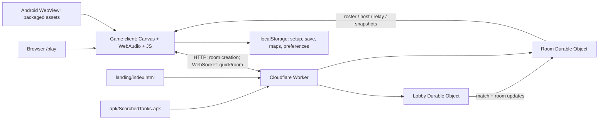
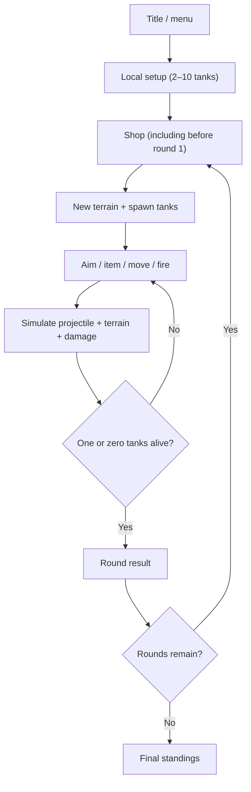

# Scorched Tanks — architecture (code review: 2026-10-31)

> Source of truth: `game/index.html`, `server/worker.js`, `android/` and deployment scripts at commit `26b9c8b` (v1.15). This describes the implementation, not an independently verified production deployment.

## System at a glance

The Worker serves the landing page, inlined browser game and APK from uploaded modules. It also routes matching and rooms. The game itself is a DOM/Canvas application; there is **no conventional front-end build or package manifest** for the game.

## Repository map

| Path | Responsibility | Important details |
|---|---|---|
| `game/index.html` | Game UI, physics, weapons, AI, terrain, local storage, network client | ~4,518 lines; two main inline scripts after `hark.js` |
| `game/hark.css`, `hark-hero.css`, `hark.js` | UI shell styles/scripts | Local dependencies, not all embedded in the source HTML |
| `landing/index.html` | Download/play/invitation landing page | Includes an independent decorative Canvas scene, not the game |
| `server/worker.js` | HTTP entrypoint, Lobby and Room Durable Objects | WebSocket relay and persistent room metadata/snapshot |
| `server/inline_assets.py` | Makes a deployable browser HTML file | Inlines matching local CSS/JS tags from `game/` |
| `server/deploy.sh` | Uploads Worker plus landing, browser HTML, APK | Uses Cloudflare Workers API and `meta-update.json` |
| `server/metadata.json`, `meta-update.json` | Initial and subsequent Worker bindings/migrations | Never reapply initial migration on an established deployment |
| `android/app/src/main/` | Android WebView, manifest, icon, deep links, native share | Java, local `file:///android_asset/index.html` |
| `android/*.gradle`, `android/app/build.gradle` | Alternate Gradle project | Version 1.0/targetSdk 34 in checked-in Gradle config, not the v1.15 release |
| `build.sh` | Historical non-Gradle APK build/signing | Not portable without replacing hard-coded paths |
| `tools/render/` | Historical promotional-art rendering scripts | Depends on external absolute paths and a pre-existing `canvas` install |
| `apk/`, `marketing/`, `docs/` | Binary, screenshots/copy, engineering documentation | APK is checked into Git |

## Game subsystems

| Approx. location in `game/index.html` | Subsystem |
|---|---|
| 839–991 | `Net`: browser/WebView networking, identity, reconnect/backoff, room API |
| 1011–1197 | Weapons/items, options, CPU profiles, seeded RNG, saved local setup, map validation |
| 1404–1719 | Canvas/world sizing, bitmap terrain, modern/classic renderer, scenery, ground settling |
| 1725–2017 | Round/shop lifecycle, economy, input state, UI |
| 2018–2699 | Items, movement, ballistics, explosions, fire, specialty weapons, CPU aim and turn simulation |
| 2702–3020 | World rendering, backgrounds, tanks and status effects |
| 3053–3266 | Touch aim, controls, setup/shop interaction |
| 3269–3399 | Save/load serialization and terrain run-length encoding |
| 3534–3819 | Online lobby, options sync, map picker/editor |
| 3839–4390 | Online rounds, shop, state sync, rejoin, CPU takeover, host migration |

These are navigation ranges, not stable API boundaries: the game is intentionally organized as one large source file rather than independent modules.

### Local game lifecycle

A match's terrain is a mutable pixel mask; blasts add/remove cells, and ground/tanks can settle. The modern renderer adds deterministic visual texture and decorative objects without changing the seeded gameplay RNG. User-designed maps are 160 height samples plus optional scenery objects.

### Online game lifecycle

The client connects to `/ws/quick` for matchmaking or `/ws/room/CODE` for a room. The Room DO stores room settings, seat roster, current host PID and a last host-supplied snapshot. The **client elected host** manages turns, round generation and shop resolution; the server **relays** most gameplay messages rather than simulating shots or enforcing economy rules. Other clients simulate locally and accept the host's state corrections. On host disconnect, Room elects a connected player and passes a snapshot; away players become CPU-controlled on the host.

Quick matchmaking waits 20 seconds once two players queue, or starts immediately when four are queued. `Room` limits max connected seats to 2–6, while the bundled client creates private rooms with max 4. Local matches support 2–10 tanks. Do not assume online 10-player support.

## Browser and Android differences

- Browser: full game accessed through `/play` or local files; local CSS/JS dependencies and external Google Fonts are referenced by source HTML.
- Android: Java `MainActivity` enables JavaScript, DOM storage, immersive fullscreen, screen-on behavior, Android share bridge and deep-link parsing. App content loads from packaged assets, **not** from live website.
- Deep link parser supports `scorchedtanks://join/CODE`; the checked-in manifest registers `https://scorched-tanks.yishai-k.workers.dev/join/CODE`. The marketing domain `tanks.yishaik.com` is used in documentation/landing but is **not** the registered Android App Link host in the checked-in manifest.
- Android Gradle configuration and `build.sh` differ in version, signing, target SDK and asset sources; there is no verified single, reproducible release pipeline.

## Data and persistence

| Key | Content | Scope |
|---|---|---|
| `st-pid` | Random persistent player identifier | Network client; not an authentication credential |
| `st-name` | Display name | Network client |
| `st-setup` | Local match options and per-mode player slots | Browser/WebView localStorage |
| `st-save` | Local match snapshot, including RLE terrain bitmap (`v:2`) | Single local saved game; not online |
| `st-maps` | Up to 30 created maps (`n`, 160-element `h`, optional `d`) | Browser/WebView |
| `st-gfx` | `modern` or `classic` | Browser/WebView |
| `st-muted` | Audio preference | Browser/WebView |
| `st-online-cfg` | Remembered online-lobby match options | Browser/WebView |

Other local preferences are persisted in the game as well. Browser-origin localStorage and APK's file-origin WebView storage are **not a shared sync service**. Reinstalling, clearing app data or changing origin may lose settings/saves. No cloud save service is implemented.

## Boundaries and caveats

- `pid` and room codes are client-provided; there is no authenticated user system.
- The host is authoritative by client convention, **not** a server-side trusted simulation.
- The Room DO persists roster metadata and a snapshot; Lobby's queue/open-room index is in-memory.
- WebSocket frames have a 2,000,000-character input guard in `Room.onMsg`, but this is not an overall quota/rate limit.
- Game version mismatches show warnings rather than blocking connection; compatibility needs active regression testing.

See [PROTOCOL.md](PROTOCOL.md), [TESTING.md](TESTING.md) and [REVIEW-2026-10-31.md](REVIEW-2026-10-31.md).
